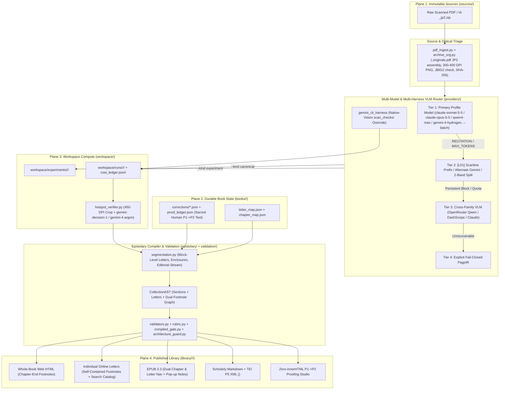
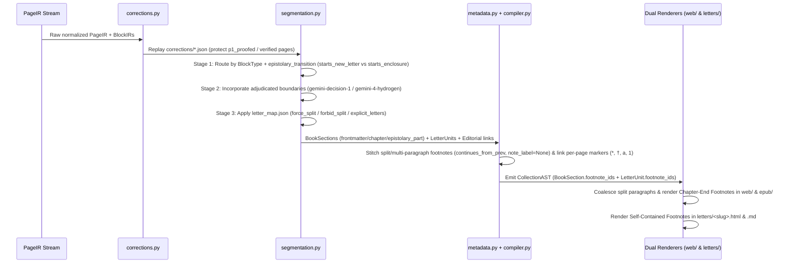

# Paper Lanterns v2 — Technical Architecture Specification

Paper Lanterns v2 is an **evidence-backed archival correspondence compiler**. Rather than cleaning raw OCR strings with ad-hoc regular expressions, it enforces a strict unidirectional pipeline:

> **Scans -> Visual Observation Wire -> Normalized `PageIR`/`BlockIR` -> Human Corrections Overlay -> Block-Level Epistolary Compiler -> Validated `CollectionAST` -> Multi-Format Editions & Proofing Studio**

---

## 1. End-to-End Compiler Dataflow



---

## 2. Strict Acyclic Subsystem Layering

`src/lanterns/validation/architecture_guard.py` parses every Python file in `src/lanterns/` with `ast` and enforces a strict acyclic import order:

```mermaid
flowchart LR
    CORE["core (models, paths, config, pricing, cost, tags, unicode_norm)"]
    SRC["source (archive_org IIIF & JP2)"]
    PROV["providers (gemini, gemini_cli_harness, openai_compat, anthropic, router)"]
    EXT["extraction (pdf_ingest, normalize, line_wraps, pipeline, batch_runner, hotspot_verifier)"]
    EPI["epistolary (corrections, segmentation, metadata, compiler)"]
    VAL["validation (validators, rubric, compiled_gate, architecture_guard)"]
    REND["renderers (html_utils, book_web, letters, epub, markdown_tei, proofing_studio, reports, catalog_status, doctor)"]
    CLI["cli (Unified lanterns CLI)"]

    CORE --> SRC --> PROV --> EXT --> EPI --> VAL --> REND --> CLI
```



### Layer Invariants
- **`core/`** is a pure leaf package depending only on the Python standard library, `pydantic`, and `jsonschema`.
- **`providers/`** is the **only** subsystem permitted to import `google.genai` or dispatch external VLM HTTP calls (`httpx` to OpenRouter, DashScope, Anthropic, DeepSeek, OpenAI).
- **`epistolary/`** operates purely on in-memory `PageIR` / `BlockIR` structures and JSON/TOML files from `books/<book_id>/`. It never imports `providers/` or `renderers/`, and contains **zero natural-language content-word regular expressions**.
- **`validation/`** computes deterministic structural findings, compiled artifact checks, the 100-Point Rubric, and AST architecture guards without importing `renderers/`.
- **`renderers/`** projects a validated `CollectionAST` into HTML5, XHTML/EPUB 3.3, Markdown, TEI P5 XML, and Proofing Studio assets without re-implementing segmentation, dehyphenation, or footnote linking.

---

## 3. Five-Plane Filesystem Contract

1. **`sources/` (Plane 1 — Gitignored Raw Inputs)**
   Holds source PDFs and Internet Archive `_jp2.zip` packages verified by SHA-256 (`source_pdf_sha256` in `book.toml`).
2. **`collections/` & `books/<book_id>/` (Plane 2 — Tracked Durable State)**
   - `collections/<slug>.toml`: Declarative defaults for extraction profile, DPI, `MEDIA_RESOLUTION_ULTRA_HIGH`, fallback chain, and publishing palette.
   - `books/<book_id>/book.toml`: Provenance metadata, `archive_id`, `active_run_id`, and per-book profile overrides.
   - `books/<book_id>/letter_map.json` & `chapter_map.json`: Block-ID overrides (`force_split_before_block_ids`, `forbid_split_before_block_ids`, `enclosure_block_ranges`, `explicit_letters`) and explicit whole-book section boundaries.
   - `books/<book_id>/corrections/*.json` & `proof_ledger.json`: Anchor-matched edits and `P1 -> P2` human verification records keyed by `source_page_sha256` and `page_text_sha256`.
   - `books/<book_id>/scan_checks/page_NNNN.json`: Committed native-vision page inspections consumed by `gemini_cli_harness`.
3. **`workspace/` (Plane 3 — Gitignored Ephemeral Compute)**
   - `workspace/experiments/<book_id>/<exp_id>/`: Created exclusively by `extract --kind experiment`. Compiles only to `workspace/builds/previews/<book_id>/<exp_id>/` unless explicitly overridden; never mutates `active_run_id` or `library/`.
   - `workspace/runs/<book_id>/<run_id>/`: Created exclusively by `extract --kind canonical`. Contains cached `renders/page_NNNN.png` (reclaimable via `lanterns gc --apply` after pixel verification), raw wire responses, normalized `PageIR` JSONs, `batch_jobs.json` checkpoints, `run_manifest.json`, and crash-durable `cost_ledger.jsonl`.
4. **`library/<collection>/<book_id>/` (Plane 4 — Tracked Canonical Editions)**
   Populated by `lanterns compile <book_id> --run-id <run_id> --set-active`:
   ```text
   library/<collection>/<book_id>/
   ├── collection_ast.json
   ├── edition_manifest.json
   ├── rubric_score.json
   ├── EDITION_REPORT.md
   ├── web/            # index.html, styles.css, reader.js, search_index.json, sections/<sec>.html
   ├── letters/        # index.html, index.json, styles.css, letters.js, <slug>.{html,md,json}
   ├── epub/           # <book_id>.epub (EPUB 3.3)
   ├── markdown/       # <book_id>.md
   ├── tei/            # <book_id>.tei.xml (TEI P5 with <correspDesc>)
   └── proofing/       # index.html, styles.css, app.js (zero innerHTML), manifest.json, pages/pNNNN.json
   ```
5. **`workers/proofing_relay/` (Plane 5 — Tracked Edge Relay)**
   Cloudflare Worker (`worker.js`) + D1 schema (`schema.sql`) managing volunteer page checkouts, `P1 != P2` server-side verification enforcement, and daily Git batch export.

---

## 4. Three-Stage Block-Level Epistolary Compiler & Dual Footnotes



### Key Compiler Mechanics
1. **Multi-Letter Single Pages:** Because `LetterUnit` stores ordered `block_ids` (`p0014-b0001..p0014-b0004` and `p0014-b0005..p0014-b0009`), three telegrams or short letters on page 14 split cleanly without duplicating or dropping surrounding blocks.
2. **Cross-Page Continuation, Witness Dehyphenation & Catchwords:** `_apply_cross_page_prose_joins` (`compiler.py`), `resolve_page_ir_line_wraps` + `dedup_or_join_cross_page_tagged` (`line_wraps.py`, backed by `witness_dir/*.txt` attestation and inline soft-wrap recovery), and `coalesce_continued_blocks` (`html_utils.py`) rejoin `continues_to_next` -> `continues_from_prev` paragraphs across page turns—even across `body <-> editorial` classification drift or intervening `illustration`, `caption`, and `margin_note` float plates—deduplicate printed cross-page catchwords (`Points. Points.`, `*pagoda* *pagoda*`), and insert diplomatic `[p. <folio>]` / `<pb n="N"/>` milestones without breaking continuous prose.
3. **Dual, Endnote, Side-by-Side & Multi-Paragraph Footnotes:** Same-page unlabelled continuation paragraphs (`note_label=None`) coalesce into the preceding active footnote, adjacent cross-page split footnotes stitch before callout matching, backmatter `Page N.` endnotes map via `folio_to_pnum` (with opening folio `"1"` backfill), single- and double-spaced side-by-side footnotes split cleanly (`split_side_by_side_footnote_tagged`), sub-footnote and volume legend symbols link transitively, `margin_note` labels are honored, and both `BookSection.footnote_ids` and `LetterUnit.footnote_ids` resolve independently.
4. **Nested Enclosures:** Blocks inside `starts_enclosure` .. `ends_enclosure` (or `blockquote` blocks inside an active letter prior to its outer `valediction`/`signature`) remain inside the parent `LetterUnit` with `metadata.has_enclosure = True`.
5. **Source-Order Spatial Fidelity & Multiline Tag Balancing:** Bottom-placed `dateline` blocks (after `body`, `signature`, or `postscript`) stay at the bottom of `LetterUnit.blocks` with `metadata.dateline_position = "bottom"` and emit `<closer><dateline>` in TEI P5 XML; `postscript` / `address_block` blocks following `signature` remain attached to that letter; and `split_tagged_lines_balanced` (`core/tags.py`) closes and reopens active inline tags (`<i>`, `<b>`, `<sc>`, `<sup>`, `<sub>`, `<unclear>`) around `\n` breaks before HTML/EPUB/TEI serialization.
6. **Interleaved Editorial Material:** Biographer prose (`type == "editorial"`) between letters becomes `SectionItem(kind="blocks", blocks=[...])` in the `BookSection` stream (preserving 100% of *Life and Letters* narrative) AND links via `_attach_framing_side` (`segmentation.py`) exclusively to `prev_lu.following_editorial_block_ids` (e.g. post-letter `OBSERVATIONS.` headings, even when bounded by `ornamental_break` rules) or `next_lu.preceding_editorial_block_ids`.

---

## 5. Cost Governance & Two-Tier Archival Validation

- **Fail-Closed Pricing & Ceiling Reservation:** Before dispatching any VLM request, `core/pricing.py` verifies every model in the active profile's primary, fallback, hotspot, boundary, and decision routes against `config/pricing.json`. `CostLedger` reserves conservative upper-bound spend per worker slot before the HTTP call so multi-threaded `--max-workers` runs never overshoot `--cost-ceiling-usd`.
- **AST-Level Validators (`validation/validators.py`):**
  1. `source_block_coverage` — Blocker if any non-furniture `BlockIR` on any extracted page is absent from `CollectionAST.sections` and `CollectionAST.footnotes`.
  2. `control_char_or_mojibake` — Blocker on NUL/C0 bytes, `U+FFFD`, Private Use Area glyphs, or unstripped `[L01]` scanline prefixes.
  3. `furniture_leak` — Flags repeated running headers or bare page numbers misclassified as `body` in top/bottom margin bounding boxes.
  4. `footnote_parity` — Flags `unmatched_callout` (`<sup>` without target note) and `unlinked_footnote` (`is_orphan=True`); scoped strictly to `human_only=True` confirmations so machine `scan_check` entries never suppress unresolved structural parity warnings.
  5. `epistolary_boundary_anomalies` — Flags `ambiguous` boundaries, oversized `>25`-page letters lacking headings, or multiple un-enclosed signatures inside one letter.
  6. `diacritic_and_script_integrity` — Flags NFD uncomposed marks, cross-script homoglyphs, and intra-book proper-noun accent drift (`info`/`warning` for scan check).
- **Compiled Edition Gate (`validation/compiled_gate.py`):** Parses every generated HTML, EPUB 3 (`zipfile` + strict XML on `content.opf`, `nav.xhtml`, `sec-*.xhtml` + internal `#fn`/`#fnref` anchor integrity), Markdown, TEI P5 XML (`ElementTree.fromstring` + unique `xml:id`s + `<correspDesc>`), and Proofing Studio (`zero innerHTML`, image-only `scan_url` checks excluding `.json`, and `_LEAKED_PLACEHOLDER_RE` blocking leaked `&lt;/?(?:i|b|sc|sup|sub|unclear)&gt;` tags).
