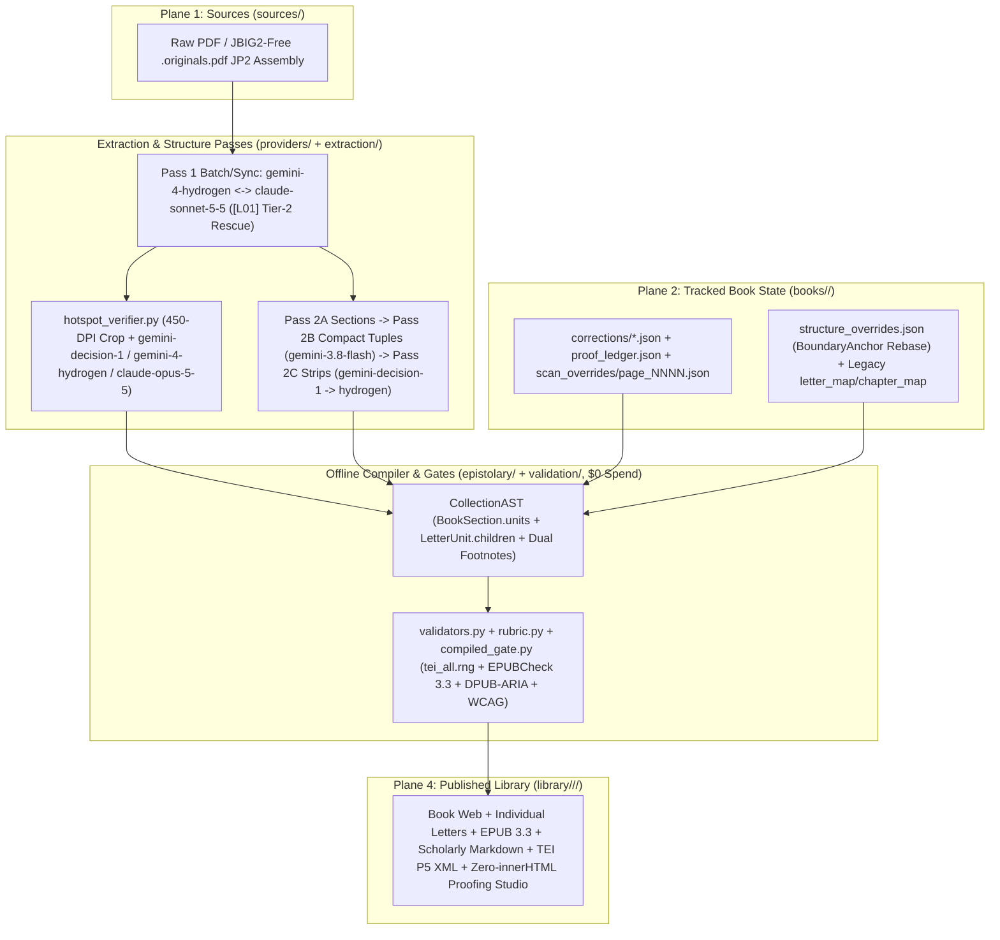

# Paper Lanterns — Unified Architecture, Standards & Proofing Specification

Paper Lanterns is an **evidence-backed archival correspondence compiler**. Rather than cleaning raw OCR strings with prose heuristics, it enforces a unidirectional pipeline:

> **Scans -> Pass-1 Wire (`<fnref>`, `facsimile_plate`) -> Normalized `PageIR`/`BlockIR` + Sacred Proof Overlay -> Pass 2A/2B/2C `BookStructurePlan` + Anchored Overrides -> Deterministic Epistolary Compiler -> Validated `CollectionAST` -> Multi-Format Editions & `P1 -> P2` Proofing Studio**

---

## 1. End-to-End Pipeline & Strict Acyclic Layering

### Acyclic Layer DAG (`validation/architecture_guard.py`)
`core -> source -> providers -> extraction -> epistolary -> validation -> renderers -> ops -> cli`

- **`core/`**: Pure leaf models (`BlockIR`, `StructuralUnit`, `ChildSpan`, `CorrespondentRef`, `BoundaryAnchor`, `CollectionAST`), paths, pricing, `CostLedger`, inline tags (`<fnref>`, ``, `split_tagged_lines_balanced`), and NFC Unicode normalization.
- **`source/`**: Internet Archive `_jp2.zip` + `scandata.xml` `.originals.pdf` assembly and BookReader `/page/n{k}_w{W}.jpg` leaf scaling.
- **`providers/`**: **Only** subsystem importing `google.genai`, `anthropic`, or external HTTP clients.
- **`extraction/`**: Optical/JBIG2 PDF triage, wire normalization, witness-backed dehyphenation & catchword deduplication, `proof_overlay.py`, Batch runner, `hotspot_verifier.py`, and whole-book `structure_pass.py` (`Pass 2A -> Pass 2B -> Pass 2C`).
- **`epistolary/`**: `100%` pure, `$0` offline compiler (`<= 160` AST branches, zero VLM imports, zero content-word regexes). Rebases `BoundaryAnchor`s (`(page_number, anchor_text_prefix, bbox_y0)`), materializes `BookSection.units` + `LetterUnit`s, and links dual footnotes.
- **`validation/`**: AST validators, 100-Point Rubric, `architecture_guard.py`, and `compiled_gate.py` (`tei_all.rng` RelaxNG, `EPUBCheck 3.3`, DPUB-ARIA 1.1, WCAG heading hierarchy, `NAV-011` monotone page order).
- **`renderers/`**: Pure structural projection (`<= 230` AST branches, zero `innerHTML`) into Web HTML, Standalone Letters, EPUB 3.3 (`EDITORIAL_EPUB_CSS` dark-mode safe), Scholarly Markdown, TEI P5 XML, and Proofing Studio.
- **`ops/`**: Repository health & anti-sprawl gate (`doctor.py`) and workspace GC / ledger reporting (`catalog_status.py`, `<= 100` AST branches).

---

## 2. Five-Plane Storage Contract

1. **`sources/` (Plane 1 — Gitignored):** Raw PDFs and `.originals.pdf` JP2 camera assemblies verified by `source_pdf_sha256`.
2. **`collections/` & `books/<book_id>/` (Plane 2 — Tracked):**
   - `book.toml`: Provenance, `language`, `text_direction` (`ltr`/`rtl`), `series_id`, `volume_number`, `archive_id`, `active_run_id`.
   - `structure_overrides.json`: Sparse human `BoundaryAnchor` overrides (`rebases` cleanly across `split_block` / page re-runs); legacy `letter_map.json` & `chapter_map.json` supported via compatibility adapter.
   - `corrections/*.json`, `proof_ledger.json`, `scan_overrides/page_NNNN.json` (wire block overrides only), and consolidated `audit_checks.jsonl`.
3. **`workspace/` (Plane 3 — Gitignored):** `experiments/<book>/<exp>/` vs. `runs/<book>/<run>/` (`ir/pages.json`, `ir/structure_auto.json`, `cost_ledger.jsonl`) vs. `builds/previews/` vs. `tools/` (`tei_all.rng`, `epubcheck`).
4. **`library/<collection>/<book_id>/` (Plane 4 — Tracked):** Compiled multi-format shelf editions (`edition_manifest.json`, `collection_ast.json`, `rubric_score.json`, `EDITION_REPORT.md`, `web/`, `letters/`, `epub/`, `markdown/`, `tei/`, `proofing/`).
5. **`workers/proofing_relay/` (Plane 5 — Tracked):** Stateless Cloudflare Worker (`worker.js`, `wrangler.toml.example`) + D1 (`schema.sql`).

---

## 3. Diplomatic Standards, Correspondence Taxonomy & 100-Point Rubric

### 3.1 Diplomatic Transcription Rules
- **Verbatim Period Ink:** Preserve archaic spellings (`shew`, `publick`), compositor errata, `[sic]`, editorial square brackets (`[? 1848]`, `[torn]`), and cipher dashes (`M——`, `Count ***`). Rejoin soft line-wrap hyphens diplomatically (`line_wraps.py`) and deduplicate cross-page catchwords (`Points. Points.`) while preserving short grammatical pairs (`if I had | had none`).
- **Unicode & Scripts (`core/unicode_norm.py`):** Store canonical `NFC`. Decompose **only** presentation ligatures `U+FB00..U+FB06` (`ff`, `fi`, `fl`, `ffi`, `ffl`). Preserve `æ`, `œ`, `Æ`, `Œ`, medial long-s `ſ` (`U+017F`), exact Hunterian (`Rájput`) vs. Geneva IAST (`Rājput`, `Śiva`, `ṛ`, `ṣ`, `ṃ`, `ḥ`), European accents as printed (`depôt` vs. `dépôt`), polytonic Greek, Cyrillic, Perso-Arabic, and Indic scripts.
- **Seven Constrained Inline Tags (`core/tags.py`):** `<i>`, `<b>`, `<sc>`, `<fnref>` (footnote/endnote callouts exclusively), `` (typographic superscripts `yᵉ`, `Sʳ`, `dº`, `ˡⁱ`, ordinals, formulas), ``, and `<unclear>`. Multiline tags balance per line via `split_tagged_lines_balanced`.

### 3.2 Historical Printed Correspondence Peculiarities Taxonomy

| # | Archival Peculiarity | Wire / AST Representation | Compiler & Renderer Behavior |
| :--- | :--- | :--- | :--- |
| **1** | **Multi-Letter Pages & Salutation-Free Notes** | `epistolary_transition="starts_new_letter"` / `StructuralUnit(kind="letter")` | Splits cleanly at exact `BlockIR` spans (`p0014-b0001..b0004`, `b0005..b0008`) |
| **2** | **Outer-Margin Chronology & Shoulder Notes** | `type="margin_note"` with left/right outer `bbox` | Preserved in reading order (`.margin-left`/`.margin-right`, TEI `<note place="margin">`, MD `> *[Margin: ...]*`) |
| **3** | **Bottom-Placed Datelines & Dual-Calendar Dates** | `type="dateline"` after `body`/`signature` | Never reordered; emits unified `<closer><dateline>` in TEI P5 |
| **4** | **Cascading Polite Valedictions & Co-Signatures** | `valediction`/`signature`, `alignment="cascading"`, `line_breaks_preserved=True` | Stepped `.align-cascading` lines; no forced italic on salutations or forced small-caps on signatures |
| **5** | **Postscripts (`P.S.`), Superscriptions & Endorsements** | `type="postscript"` / `"address_block"` | Post-body addresses join `<closer><address>`; multi-paragraph/signed P.S. tails stay inside `<postscript>` |
| **6** | **Mid-Letter Enclosures & Quoted Sub-Letters** | `ChildSpan(kind="enclosure" \| "letter_excerpt" \| "verse_insert")` | 1-level nesting inside parent `StructuralUnit`/`LetterUnit` without splitting parent letter |
| **7** | ***Life & Letters* Interleaved Biography & Reports** | `StructuralUnit(kind="narrative" \| "editorial_bridge" \| "document")` | Tessellated `
` in TEI; uniform prose flow + full-book search in Web |
| **8** | **Two-Tier Apparatus, Backmatter Endnotes & Multi-Paragraph Notes** | `<fnref>` + `type="footnote"` (`note_label`, `continues_from_prev`) | Dual projection to `BookSection`, `StructuralUnit`, & `LetterUnit`; multi-`
` HTML/EPUB/TEI & 4-space MD continuations; backlinks for all citations |
| **9** | **Centered Letter Numbers vs. Folios, Gatherings & Blank Endpapers** | Furniture = `running_header`, `folio`, `scanner_residue`, `noise` | Monotonic folio solver bounded by `[first_arabic, last_arabic]` + blank guard (`0` fake endpaper folios) |
| **10** | **Manuscript Autograph & Collotype Plates** | `type="facsimile_plate"` / `"illustration"` + `"caption"` | Clean `<figure>` representation without garbled forced cursive OCR; monotone `#page-N` order across float coalescing |
| **11** | **Multi-Page Ledger Tables with Mid-Table Subheaders** | `table_caption` + `table_row` (`table_role="header" \| "body"`) | Leading header rows in `<thead>`; mid-table subheaders preserved in source order inside `<tbody>` |
| **12** | **Polyglot & Right-to-Left (`rtl`) Series Volumes** | `language`, `text_direction`, `series_id`, `volume_number` | Dynamic `lang`/`xml:lang`, `dir="rtl"`, OPF `page-progression-direction="rtl"` & `belongs-to-collection` |

### 3.3 The 100-Point Quality Rubric & Four Provenance Tiers (`validation/rubric.py`)
1. **Text & Diacritic Fidelity (`30` pts):** Zero `U+FFFD`/C0/PUA/`[L01]` leaks (blocker); NFC, homoglyph, case-aware diacritic drift, and `<unclear>` density checks.
2. **Epistolary Structure & Layout (`25` pts):** Boundary confidence, spatial alignment preservation, enclosure integrity, and un-silenced oversized/multi-signature anomaly checks.
3. **Apparatus & Footnote Parity (`20` pts):** 1-to-1 `<fnref>` <-> `FootnoteItem` parity (`human_only=True` suppression only) and verified dual section/letter projection.
4. **Completeness & Conservation (`15` pts):** `100%` `source_block_coverage` across `items` and `units` (any dropped block or `failed_closed` page = blocker) + all-block `furniture_leak` checks.
5. **Compiled Multi-Format Validity (`10` pts):** `compiled_gate.py` verification across Web, Letters, EPUB 3.3, Markdown, TEI P5, and Proofing Studio.

**Provenance Tiers:** `blocked` (any blocker or `< 70`) -> `community` (`0` blockers, `>= 70`) -> `machine_checked` (`0` blockers, `0` hotspots, `>= 95`) -> `source_certified` (`>= 96` AND `100%` pages `verified` in `proof_ledger.json` with `p2_verifier_id != p1_reviewer_id`).

---

## 4. Distributed Community Proofing (`P1 -> P2`) & Edge Relay

- **State Machine:** `unproofed / machine_reread -> p1_proofed` (human P1 save; `machine_reread` never leaks into `p1_reviewer`) -> `verified` (human `P2 != P1` confirms zero edits; if P2 edits text, P2 becomes new P1).
- **Zero-`innerHTML` Studio (`renderers/proofing_studio.py`):** Pure `createElement`/`textContent` DOM, strict CSP (`connect-src` restricted to `'self'` + configured relay origin), WebCrypto SHA-256 fail-closed check, per-page `forceSplits`/`forbidSplits`/`note_label` controls, local scan presence flag (`data-has-local-scans`), and `POST /api/claim` lease acquisition before save/verify.
- **Cloudflare Worker + D1 Relay (`workers/proofing_relay/`):** Mandates valid non-empty `lease_token` and `Bearer` auth on write/verify, preserves round-scoped `p1_proposal_json` across empty P2 sign-offs, enforces `p2_verifier_id != p1_reviewer_id` in SQL + Worker, and exports verified batches daily to Git (`lanterns intake` -> `$0` `lanterns compile`).

---

## 5. Six-Vector Adversarial Audit Checklist

Before certifying any release or edition, verify against real rendered `.png` scans via native vision (`read_file`):
1. **Pixel-to-Glyph Fidelity:** Inspect `>= 6` rendered page PNGs across hard leaves; confirm `0` modernizations, intact `ſ`/`æ`/`œ`, exact Hunterian/IAST/European/Indic/Greek glyphs, and verbatim `[sic]`/cipher dashes.
2. **Epistolary & *Life & Letters* Structure:** Confirm multi-letter pages, cross-page split paragraphs, `ChildSpan` enclosures, bottom datelines, postscripts, shoulder `margin_note`s, and interleaved narrative/documents segment cleanly in exact source order.
3. **100% Conservation & Dual Footnotes:** Confirm `source_block_coverage == []`, cross-page/multi-paragraph/endnote stitching, multi-citation backlinks, and bidirectional `#fnref-*` <-> `#fn-*` anchors in both section and standalone-letter views.
4. **Standards-Compliant Multi-Format Gates:** Confirm `0` `tei_all.rng` RelaxNG errors (tessellated `
`, unified `<opener>`/`<closer>`, per-line `<lg><l>`, CMIF `<correspDesc>`), `0` `EPUBCheck 3.3` / `NAV-011` / DPUB-ARIA / WCAG heading-skip errors, dark-mode-safe `EDITORIAL_EPUB_CSS`, and mid-table subheader preservation.
5. **Security & Sacred Human Text:** Confirm `0` `innerHTML`/`outerHTML`/`insertAdjacentHTML`, strict CSP on `web/`, `letters/`, and `proofing/`, non-zero CLI exit on gate failure, and P1/P2 human text immunity across re-extractions.
6. **AST Guard & Plane Isolation:** Confirm `./verify`, `uv run lanterns doctor`, and `uv run lanterns benchmark` pass under ratcheted branch/complexity caps with clean `git status`.
