# Distributed Community Proofing Design (`P1 -> P2`)

Paper Lanterns v2 integrates a lightweight, zero-`innerHTML` **Community Proofing Studio** (`library/<collection>/<book_id>/proofing/`) paired with an optional **Cloudflare Worker + D1 Relay** (`workers/proofing_relay/`). Inspired by **Distributed Proofreaders (DP)**, **Wikisource ProofreadPage**, and **Library of Congress By the People**—while copying zero GPL/AGPL code—it enables volunteers worldwide to certify public-domain correspondence leaf by leaf without requiring GitHub accounts or standing server maintenance.

---

## 1. Two-Round Page State Machine (`P1 -> P2`)

The physical **scanned page** is the unit of proofreading. A book becomes `source_certified` when every page reaches `verified`:

```mermaid
stateDiagram-v2
    [*] --> unproofed: Initial VLM Extraction
    unproofed --> machine_reread: verify-hotspots / scan_check
    unproofed --> p1_proofed: P1 Human Volunteer Saves Page
    machine_reread --> p1_proofed: P1 Human Volunteer Saves Page
    p1_proofed --> verified: P2 Trusted Verifier (P2 != P1) Confirms Zero Changes
    p1_proofed --> p1_proofed: P2 Makes Edits (Becomes New P1; Needs Fresh P2)
    verified --> needs_review: Reader Flags Issue (Never Mutates Text Directly)
    needs_review --> p1_proofed: Reviewer Resolves & Re-Saves
```

### Governing Invariants
1. **Two Distinct Human Eyes (`p2_verifier_id != p1_reviewer_id`):** Both `epistolary/corrections.py` (`intake_proposal`) and `workers/proofing_relay/worker.js` reject self-verification. If a second reviewer modifies text on a `p1_proofed` page rather than confirming it as-is, that reviewer becomes the new `p1_reviewer_id` and one further independent confirmation is required to reach `verified`.
2. **Human Text Is Sacred (Never Overwritten by AI):** Once a page reaches `p1_proofed` or `verified` in `books/<book_id>/proof_ledger.json`, subsequent VLM re-extractions **never** overwrite the human-certified text (`epistolary/corrections.py`), and empty `accepted_blocks: []` snapshots are rejected when non-empty `PageIR.blocks` exist. `intake_proposal` hashes post-`resolve_page_ir_line_wraps` text with `witness_dir`, and `_locate_target_block_index` matches 120-char anchors against the head slice (`[:len(anchor) + 40]`) of long paragraphs.
3. **Cryptographic Lineage:** Every sign-off records `source_page_sha256` (binding to the exact scan pixels) and `page_text_sha256` (binding to the exact compiled diplomatic text).

---

## 2. The Volunteer One-Page Rulebook: *"Type What the Printer Printed"*

Volunteers do not need to learn TEI XML or Python schemas. One rule governs every decision:

1. **Match the Scan, Not Modern English:** Keep historical spellings (`shew`, `connexion`, `publick`), original printer typos (`recieve`), `[sic]`, editorial square brackets (`[? 1848]`, `[torn]`), and anonymizing cipher dashes (`M——`, `Count ***`) exactly as printed.
2. **Keep Historical Letterforms & Accents:** Use the built-in Character & Diacritic Palette for medial long-s (`ſ`), ligatures (`æ`, `œ`, `Æ`, `Œ`), Hunterian acutes (`Rájput`), IAST Sanskrit marks (`Śiva`, `ṛ`, `ṣ`, `ṃ`, `ḥ`), French/German accents (`depôt`, `für`), and inline scripts. Do **not** add an accent the printer omitted, and do **not** drop one the printer set.
3. **Six Simple Inline Tags Only:**
   - `<i>italics</i>`, `<b>bold</b>`, `<sc>Small Caps</sc>`, `superscript` (for footnote callouts like `*` or `Mme`), `subscript`, and `<unclear>faded word</unclear>` when ink is genuinely illegible on the scan.
4. **Verify Epistolary Boundaries & Layout:** In the **Epistolary Boundary & Metadata Panel**, check that:
   - Each new letter, telegram, or note on the page starts cleanly (`starts_new_letter`).
   - Letters quoted *inside* another letter are marked as enclosures (`starts_enclosure` / `ends_enclosure`), not split into separate letters.
   - Multi-line salutations, cascading valedictions, bottom-left datelines, postscripts, and outer-margin notes (`margin_note`) keep their printed block type and line breaks.
5. **When Uncertain, Mark `<unclear>` or Leave a Note:** Never guess silently.

---

## 3. Zero-`innerHTML` Studio Architecture & Scan Streaming

`src/lanterns/renderers/proofing_studio.py` compiles a static, self-contained application into `proofing/`:
- **Strict Security by Construction:**
  - **Zero `innerHTML`, `outerHTML`, or `insertAdjacentHTML`** anywhere in `app.js` or `proofing_studio.py` (enforced by `lanterns doctor` and `compiled_gate.py`). Every DOM node is built via `document.createElement` and `textContent`.
  - Ships a strict `<meta http-equiv="Content-Security-Policy">` blocking inline scripts and unauthorized external origins.
  - Page data ships as pure JSON shards (`proofing/pages/pNNNN.json`), never interpolated into `<script>` strings.
- **Dual-Mode Scan Viewer (Zero-Storage Archive.org Scaler/IIIF + Offline Local Bundle):**
  - When `archive_id` is configured, streams scans directly from Internet Archive using `archive_org.build_iiif_page_url` (`https://archive.org/download/<id>/page/n<N>_w<W>.jpg` 0-based BookReader leaf scaling and IIIF `full/max/0/default.jpg` + `info.json` for OpenSeadragon—avoiding IA's HTTP 403 scale-exceeded error on `full/1600,` when narrow octavo JP2 camera scans are `< 1600px` wide) so hosting requires zero scan storage.
  - When built with `--bundle-scans` or opened locally offline, renders image-only local page scans (`proofing/scans/*.png|.jpg|.webp`, never `.json`) seamlessly with native pan/zoom controls and synchronized `0..1000` bounding-box highlight overlays across both Whole-Book `web/` pages and Individual Online Letter `letters/<slug>.html` (`#scan-drawer` + `../web/reader.js`).
- **Hotspot Jump (`Alt+H`):** Volunteers can jump directly to validator-flagged blocks (`<unclear>`, `unmatched_callout`, `ambiguous` letter boundary) or proof sequential pages.
- **Dual Export Path:** Saves work either by downloading a schema-valid `proposal.json` (`schemas/correction_v2.schema.json`, ingested via `uv run lanterns intake <book_id> proposal.json`) or POSTing to the Cloudflare Worker relay.

---

## 4. Cloudflare Worker + D1 Relay & Daily Git Sync (`workers/proofing_relay/`)

To keep the internet-facing edge simple, zero-maintenance, and free of GitHub write tokens:

1. **`workers/proofing_relay/schema.sql` (Cloudflare D1):** Stores work-in-progress page checkouts (short 30-minute reservation locks preventing duplicate effort), submitted `correction-v2` payloads, pseudonymous reviewer IDs, and `P1 -> P2` status transitions (`CHECK (p2_verifier_id IS NULL OR p2_verifier_id != p1_reviewer_id)`).
2. **`workers/proofing_relay/worker.js`:** Validates incoming JSON payloads, enforces page checkout locks and `verifier != author` server-side, supports anonymous reader "Flag Page" requests (which raise queue priority without altering text), and exposes an authenticated read-only `/api/export-verified` batch endpoint.
3. **Git as Permanent Source of Truth:** A scheduled daily job pulls verified proposals from `/api/export-verified`, commits them to the durable data store (`books/<book_id>/corrections/` and `proof_ledger.json` via `lanterns intake`), and re-runs `lanterns compile` at `$0` VLM cost. D1 holds only transient queue state and can be rebuilt from Git at any time.
4. **Provenance Tier Progression:**
   `blocked` -> `community` (0 blockers, Rubric >= 70) -> `machine_checked` (0 blockers, 0 hotspots, Rubric >= 95) -> `source_certified` (100% pages `verified` with `P1 != P2`, Rubric >= 96).
